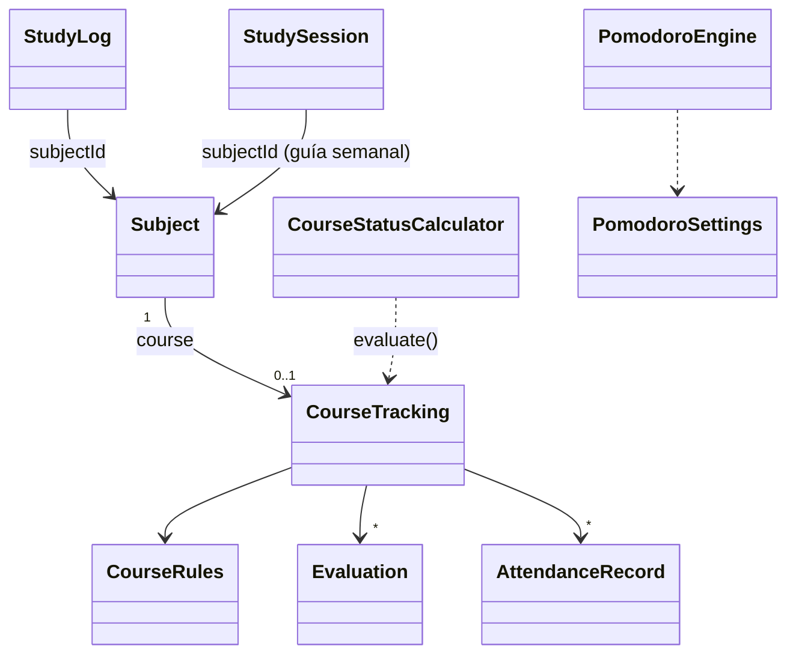

# Planificador de Estudio Desktop (Java)

Aplicación nativa de escritorio desarrollada en **Java (Swing + FlatLaf)** para la gestión completa de plan de estudio universitario, materias, guía semanal y fechas importantes.

## ✨ Funciones
- **Hoy**: lo planeado para hoy y la **cuenta regresiva** de las fechas importantes de los próximos 30 días ("Primer parcial (Mecánica de Fluidos) en 6 días"; en rojo las de 7 días o menos).
- **Guía semanal**, **Materias** (unidades y temas), **Fechas clave** y **Progreso**, como antes.
- **🍅 Pomodoro** (botón en Hoy y en Tiempo): elegís materia y, si querés, tema; ciclos de 25 min de estudio y 5 de descanso, con un descanso largo de 15 cada 4 ciclos. Los cuatro valores se cambian con **⚙ Ajustes**. Al terminar cada fase el reloj se frena y suena un aviso. Cada ciclo de estudio terminado se guarda como sesión de estudio (`studyLogs`); saltear una fase no guarda nada.
- **⏳ Tiempo**: por materia, lo estudiado con el Pomodoro en la semana elegida contra lo planeado en la guía semanal (suma de los minutos de la guía), y una tabla de las últimas 8 semanas.
- **🎓 Cursada**: por materia cargás las reglas (asistencia mínima, nota para regularizar y para promocionar, cantidad de parciales, cuáles tienen recuperatorio y cuántas clases tiene el cuatrimestre), las notas de parciales, recuperatorios y TP, y la asistencia de cada clase. Calcula la condición (**promoción, regular, libre o en curso**) y cuánto falta ("Podés faltar 2 clases más", "Parcial 2: falta rendir (necesitás 6 para regularizar y 8 para promocionar)").

### Reglas de cursada que usa el cálculo
- Asistencia = presentes / clases registradas. Si se cargó la cantidad de clases del cuatrimestre: faltas permitidas = ⌊clases × (100 − mínimo) / 100⌋ y queda libre si las supera. Si no se cargó: queda libre si el porcentaje actual es menor al mínimo.
- Un recuperatorio **reemplaza** la nota del parcial (aunque sea más baja). Si hay dos notas del mismo parcial, vale la última cargada.
- Un parcial desaprobado con recuperatorio todavía sin rendir está "a recuperar" (en curso); sin recuperatorio, o con el recuperatorio desaprobado, deja **libre**.
- **Promoción**: todos los parciales con nota ≥ la de promoción y la asistencia al día. **Regular**: todos ≥ la de regularizar. **En curso**: falta rendir o recuperar algún parcial, o faltan clases por registrar.
- Los TP se cargan y se muestran, pero no cambian la condición.

## 🚀 Requisitos
- Java JDK 17 o superior.
- Maven 3.6+.

## 🛠️ Cómo Compilar y Ejecutar

### Opción 1: Ejecutar directamente con Maven
```bash
mvn clean compile exec:java -Dexec.mainClass="com.planificador.Main"
```

### Opción 2: Generar JAR Ejecutable y ejecutar
```bash
mvn clean package
java -jar target/planificador-estudio-desktop-1.0.0-jar-with-dependencies.jar
```

## 💾 Dónde se guardan los datos
Los datos viven siempre en el mismo archivo, sin importar desde qué carpeta se abra la app:

```
~/.local/share/planificador-estudio/planificador_datos.json
```

(o `$XDG_DATA_HOME/planificador-estudio/` si esa variable está definida). Las sesiones del Pomodoro (`studyLogs`), sus ajustes (`pomodoroSettings`) y la cursada de cada materia (`course`) van en el mismo archivo; son campos opcionales, así que un archivo de una versión anterior carga igual. Se guarda primero en un temporal y después se reemplaza, así un corte a mitad de escritura no deja el archivo roto. Si el archivo no se puede leer, se guarda una copia `planificador_datos.json.danado-<fecha>` antes de cargar los datos de ejemplo.

Las versiones anteriores guardaban `planificador_datos.json` en la carpeta desde donde se abría la app. Al primer inicio, si la ubicación nueva no existe, se **copia** el más reciente de esos archivos viejos (carpeta actual o carpeta personal); el original no se borra.

## 🧪 Tests
```bash
mvn test
```
Los tests nunca tocan los datos reales: usan carpetas temporales (`XDG_DATA_HOME` apunta a `target/` y `java.awt.headless=true`). `PantallasTest` arma y dibuja todas las pantallas sin abrir ventanas; con `-Dcapturas=<carpeta>` guarda una imagen de cada una.

Esta etapa la programaron modelos locales (qwen3.5-9b y Gemma 4 E4B) con Claude diseñando y evaluando: ver `docs/llm/`.

## 📂 Estructura del Proyecto
- `com.planificador.Main`: Punto de entrada de la aplicación.
- `com.planificador.model`: Modelos de datos (Subject, Unit, Topic, StudySession, ImportantDate; nuevos: StudyLog, PomodoroSettings, CourseRules, CourseTracking, Evaluation, AttendanceRecord).
- `com.planificador.service`: `DataManager` (JSON) y la lógica nueva, sin Swing y con tests: `Countdown`, `StudyTimeStats`, `PomodoroEngine`, `StudyLogFactory`, `CourseStatusCalculator`.
- `com.planificador.ui`: Swing (MainWindow, TodayPanel, WeeklyPanel, SubjectsPanel, DatesPanel, StatsPanel, TimerDialog; nuevos: CountdownPanel, PomodoroPanel, PomodoroDialog, StudyTimePanel, CoursePanel, CourseRulesForm, EvaluationForm).


